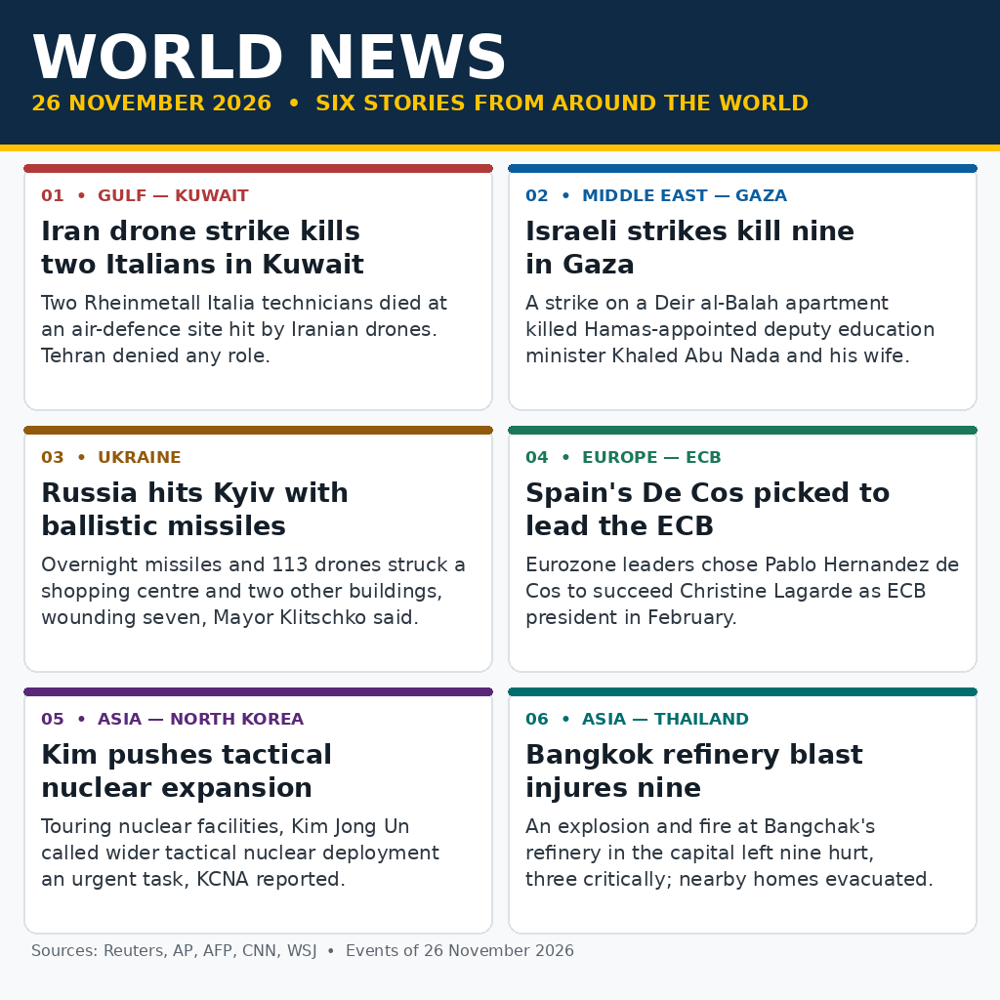

# World News — 26 November 2026

[](https://make.fun/bounty/news-image-20261126) [](https://make.fun/bounty/news-image-20261126) [](https://make.fun/bounty/news-image-20261126)

One image summing up the world's news of Thursday, 26 November 2026.
Entry for the [make.fun bounty](https://make.fun/bounty/news-image-20261126) `news-image-20261126`.



## The six stories

1. **Iran drone strike kills two Italians in Kuwait** (Gulf / Kuwait) — Two Rheinmetall Italia technicians died at an air-defence surveillance station hit by Iranian drones; two others were wounded. Italy and Kuwait blamed Iran; Tehran denied any role. (Reuters, CNN, WSJ, BBC — 26 Nov 2026)
2. **Israeli strikes kill nine in Gaza** (Middle East) — Israeli airstrikes and gunfire killed at least nine Palestinians overnight, including Hamas-appointed deputy education minister Khaled Abu Nada, killed with his wife in a strike on a Deir al-Balah apartment — a third consecutive night of attacks despite the ceasefire. (Reuters, Arab News / AFP — 26 Nov 2026)
3. **Russia hits Kyiv with ballistic missiles** (Ukraine) — Russia struck Kyiv overnight with ballistic missiles and 113 drones, hitting a shopping centre and two other buildings and wounding seven people, Mayor Vitali Klitschko said. (Reuters — 26 Nov 2026)
4. **Spain's De Cos picked to lead the ECB** (Europe) — Eurozone leaders chose Pablo Hernández de Cos, former governor of the Bank of Spain, to succeed Christine Lagarde as president of the European Central Bank in February — the first Spaniard to hold the post. (Reuters, AP, Le Monde, WSJ — 26 Nov 2026)
5. **Kim pushes tactical nuclear expansion** (Asia / North Korea) — Touring nuclear material production and weapons research facilities, Kim Jong Un said North Korea should deploy tactical nuclear weapons across multiple domains and called the task urgent, state media KCNA reported on Thursday. (Reuters, CNN — 26 Nov 2026)
6. **Bangkok refinery blast injures nine** (Asia / Thailand) — An explosion and fire at Bangchak's oil refinery in eastern Bangkok injured at least nine people, three critically, briefly forcing nearby residents to evacuate; production was halted. (AP, CNN, AFP — 26 Nov 2026)

Sources: Reuters, AP, AFP, CNN, WSJ. Events of 26 November 2026.

## How it runs

`main.py` (Python 3 + Pillow) draws the image programmatically and writes `entry.png` next to itself:

```sh
python3 main.py
```

The output is `entry.png` — a 1024×1024 PNG, under 1 MiB.

## License

MIT — see `LICENSE`.
